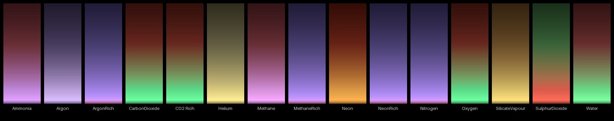

# Auroras

On a planet whose atmosphere's kind is known (`aurora = 1`), edworld draws an aurora over the night side: an oval of
curtains around each magnetic pole, as high as its kind's air makes it (below), in the colours of the
planet's gas. Like the clouds it comes from what the game draws only. The game models no magnetic field, no star's
wind and no storms, so most of what makes an aurora is a guess, the same planet always the same and the same for
everyone. This page says what is read, what is physics carried over from the Earth, and what is a choice, then
which colours there are and how often you will meet each.

*A curtain of each kind from its foot (bottom) to the shell's ceiling (top), as the shader mixes them; the brightest
channel 1, so the kinds' different yields are not shown. Nitrogen's pink edge is the thin line at the very foot.*

## What is read, what is carried over, what is a choice

| what | where it comes from | kind of knowledge |
|---|---|---|
| the atmosphere's kind | the game's own atmosphere table, matched to one of 15 prints (see [clouds.md](clouds.md)) | read off the render |
| the planet's radius and day | the planet's shell and how its object matrix turns | read off the render |
| the star's class | the red over green of the star's light on the planet (one value per class: M 1.044, K 1.032, G 1.012, F 1.003, A and hotter 0.982, brown dwarfs over 1.5; 80 planets of two commanders) | read off the render |
| how far the star is | the level of that light, which follows the flux only weakly (about its power 0.14), so it scales the wind within 0.5-2 | read off the render, squeezed by the game |
| the time | the game's UTC | read |
| the oval: magnetic latitude 67° - 2° K at midnight, 77° - 1° K at noon, 3-8° wide | the Earth's | physics, carried over unscaled |
| how stormy: a Kp-like level 0-9 per 3 hours, 0-2 six times in ten | the Earth's statistics | physics, carried over |
| substorms every 1.5-3 hours: growth, breakup, expansion, recovery | the Earth's | physics, carried over |
| the colours | the gases' emission lines (below) | physics, except methane, ammonia and silicate vapour (only to tell them apart) |
| a bright part of an arc wider, lower at its foot and taller | more and harder particles go deeper | physics, the amounts a choice |
| the rays: a strong one bright, long and coming down deeper; the colour by the height, the high colour only at the tops of the long ones | harder particles go deeper; each gas's lines by height (oxygen green low, red high) | physics, the rays' sizes and times a choice |
| whether a planet has a field | a dynamo needs a large, turning, warm inside | the reason physics, the chances a choice |
| how active a star is for its class | convective envelopes: M most, hot stars little | the order physics, the numbers a choice |
| how high it stands | where the air thins as the Earth's over 100 km: the scale height from the gas, the temperature and the gravity, and the surface pressure | physics with the kind's typical planet (the radius read off the render), the air taken as at the surface's temperature all the way up; the bounds a choice |
| how much the curtains dance, the gaps along an arc, the local wiggles and curls | substorms, Alfvén waves, the instabilities of the sheet of current (on the Earth curls of 5-10 km, folds of 20-50 km) | how fast and how much a choice |

## Colours by atmosphere

The share is of the landable planets with an atmosphere in the author's scans (1843 of 11820 landable planets, two
commanders, each planet once). "Field" is the mean chance edworld gives those planets of a field of their own (the
rest show only a faint glow, see below).

| kind | low in a curtain / high in it | from | yield | share | field |
|---|---|---|---|---|---|
| CarbonDioxide | green / red | oxygen 557.7 / 630 nm | 0.5 | 24.9% | 19% |
| Neon | orange / red | neon 585 / 640 nm | 0.8 | 18.4% | 67% |
| SulphurDioxide | red / green | oxygen as on Io | 0.4 | 15.4% | 30% |
| Argon | lilac | argon, mostly infrared | 0.3 | 13.9% | 30% |
| Ammonia | violet / red | nitrogen and hydrogen (to tell apart) | 0.5 | 8.5% | 17% |
| NeonRich | violet-blue, pink foot | nitrogen N2+ 391 / 428 nm | 0.6 | 7.3% | 63% |
| Methane | violet-pink / red | hydrogen and CH (to tell apart) | 0.4 | 4.9% | 6% |
| Nitrogen | violet-blue, pink foot | nitrogen N2+ 391 / 428 nm | 0.6 | 2.5% | 50% |
| ArgonRich | violet-blue, pink foot | nitrogen | 0.6 | 1.7% | 48% |
| CarbonDioxideRich | green / red | oxygen | 1 | 1.0% | 57% |
| Helium | yellow | helium 587.6 nm | 0.2 | 0.8% | 67% |
| MethaneRich | violet-blue, pink foot | nitrogen | 0.6 | 0.3% | 50% |
| Water | green / red | oxygen and hydrogen | 0.6 | 0.3% | 4% |
| Oxygen | green / red | oxygen 557.7 / 630 nm | 1 | 0.2% | 37% |
| SilicateVapour | yellow / orange | sodium (to tell apart) | 0.5 | 0.1% | 70% |

The "Rich" kinds take their main gas: NeonRich, ArgonRich and MethaneRich mostly nitrogen, CarbonDioxideRich mostly
oxygen. So of the planets you can land on, about two in five show oxygen's green and red (carbon dioxide, water,
oxygen and the rich carbon dioxide, and sulphur dioxide's reversed red and green), one in five neon's orange, one in
eight nitrogen's violet-blue, one in seven argon's faint lilac.

## Where, and how often

**A field of its own** comes from the chance by radius (0.15 under 1000 km, 0.4 to 3000 km, 0.7 past), a third of
it for a planet that turns slowly (radius over the Rossby radius under 0.3, or a day over 10 days, a weak dynamo), a
third more for a volcanic neon world (edworld tells it by the second neon print; the table above counts the
journal's volcanism instead). Of the landable planets with an atmosphere 18% are under 1000 km, 31% 1000-3000 km,
50% larger; 54% turn slowly. In all **36% have a field**: neon and the nitrogen kinds most often (large, cold,
fast-turning worlds), carbon dioxide, ammonia, methane and water seldom (small or slow). Without a field only a faint
patchy glow covers the night side, as on Mars and Venus, where the star's wind meets the air directly.

**The star** sets how strong the wind is: activity M 1, K 0.6, G 0.5, F 0.3, brown dwarfs 0.3, hotter 0.1. Neon
worlds circle brown dwarfs (54%) and M stars (35%), argon M stars (56%), carbon dioxide and ammonia mostly F, G and K
stars. A strong wind makes the storm up to 3 levels stronger, so an argon or nitrogen world by an M star storms more
often than a carbon dioxide one by an F star.

**When.** The level is drawn for each 3 hours of UTC and the planet: 0-2 six times in ten, 3-4 three, 5-6 about one,
7-9 rarely (3 in 100); the last 20 minutes go over to the next. From level 3 substorms come every 1.5-3 hours (the
planet's own period): the arc drifts 2° toward the equator for 40% of it, breaks up (a part of it brightening),
expands toward the pole with the aurora at its brightest and moving most to 60%, then pulses as it recovers. The
whole aurora's brightness changes only over minutes, at most 2.5 times its quiet level, so it never flashes as one;
what moves in seconds is local:

- waves of brightness running along the arcs, three times as bright here and a third there;
- curtains folding and swaying by a degree or two;
- each arc wiggling across itself on its own, in bumps a twentieth of the oval long that change in about two seconds and
  drift along it, by up to 1.5 times its thickness (half that in a quiet sky);
- curls: here and there an arc winds into an S about a small vortex that grows and fades over 16 seconds, in about a third
  of the oval's 12 parts at a time in a quiet sky, up to 70% in a substorm;
- small patches flickering about 8 times a second, at most 15% (`aurora_flicker = 0` turns this off).

Besides, its rays grow and fade, each on its own over 2-6 seconds, in groups about 10 km long, in a quiet sky too.

`aurora_dance` scales all of it (`0` = without the waves, the fast folds, the wiggles, the curls and the flicker; the rays still grow and fade); a weak storm dances less, three quarters at level 4.

**The arcs.** One arc in a quiet sky; a second one poleward of it from level 3; a third further poleward while a
substorm expands from level 6 (by the time alone about 7.5% of the time is at level 6 or more, and the expansion is a
fifth of each substorm, so the third arc is rare). No arc runs all round: each has its own dark gaps, drifting over
minutes, about half of it dark in a quiet sky, a quarter in a strong storm, more again as a substorm recovers, so in
one place there may be none, one, two or three. Where an arc is bright it is wider and its foot lower; a faint part
stands higher, thin and short. Each curtain is a thin, tall sheet, as the particles come down
along the field's lines, nearly upright near the pole, in sheets a few km thin: about 4 km thick (2.8-5.2 by its
brightness), sharp at its foot and fading slowly upward over most of the shell, coloured from the gas's low colour
to its high one by the height. It is made of dense rays, one about each km and a wider one about each 2.5 km, each
with a strength of its own that changes smoothly over 2-6 s and is alike in its neighbours (groups about 10 km long,
changing in about 6 s). A strong ray is bright, reaches high and comes down deeper, as harder particles do; a weak one
is faint and short. So the curtain's foot and top are both uneven, and only the long rays reach the high colour (for
oxygen the red), the short ones stay in the low one; a faint sheet glows low between the rays. A faint diffuse glow lies beside the arcs. The
lines lean 10-15° on the Earth; edworld draws the curtains upright.

**How high.** On the Earth an aurora's foot stands about 100 km up, where the electrons have gone through as much
air as lies over it; its red tops reach 300 km and more. edworld puts the foot where as much of the kind's air lies
over it: the scale height H = R T / (M g) from the gas, the surface's temperature and the gravity, and the surface
pressure, z = H ln(p0 / p100), p100 the Earth's 0.032 Pa scaled by the gravity. edworld reads only the radius, so it
takes the kind's typical planet (the medians of 1843 scanned planets; the gravity over the radius is nearly the same
within a kind) and the air as at the surface's temperature all the way up (the Earth itself comes out at 126 km so).
The foot stays within 20 km .. 1000 km and half the radius, where this model fails (a small warm planet's air would
reach thousands of km), and over the clouds' top; the ceiling is three times as high. The game draws every
atmosphere's shell about 95 km high whatever the planet (measured on 53 planets), so the aurora of a cold neon world
(about 40 km, over its clouds) stands in the game's sky, and that of a small carbon dioxide or ammonia world (200-500
km) far over it.

| kind | the foot on the typical planet |
|---|---|
| Neon, NeonRich | 20-60 km, mostly over the clouds' top |
| SulphurDioxide, Argon, Nitrogen, ArgonRich, Helium, MethaneRich | 80-110 km |
| CarbonDioxideRich, Oxygen, CarbonDioxide (large) | 115-160 km |
| CarbonDioxide (small), Ammonia, Methane, Water | 200 km up to half the radius |

**Where on the planet.** The oval lies about the magnetic pole, whose dipole leans 0-12° off the axis the planet
turns on on nine planets of ten and 15-60° on the tenth (as Uranus); it turns with the planet, so the oval sways in
a day. Only the night side shows it; from the ground only under a dark sky, through the clouds' gaps; from orbit over
the clouds, past the planet's night edge too. From the ground go to high latitudes on a planet with a field, at
night: under a strong storm the oval comes down toward the equator and passes over you.

To look at it on any planet whose kind is known: `aurora_activity = 7` and `aurora_field = 1` (a field of its own
whatever the guess; `0` = never).

## Examples

Landable planets in the Bubble (within 250 ly of Sol) with the best chance of a field in each kind, from the
author's scans (radius, the star class read as edworld reads it, left out for hotter or unknown stars, the chance).
Whether a given one has a field is still the draw from its seed.

| kind | planets |
|---|---|
| CarbonDioxide | Ngardinja 4 (3512 km, F, 70%); MCC 515 CD 3 (3217 km, 70%); Marsinatani A 3 (3018 km, G, 70%) |
| Neon | Col 285 Sector BH-I b24-10 6 (6466 km, M, 91%); Trianguli Sector EM-L a8-0 1 (6223 km, brown dwarf, 91%); Col 285 Sector RX-Q a48-3 1 (6131 km, brown dwarf, 91%) |
| SulphurDioxide | Ngardinja 1 (2985 km, F, 40%); HIP 10050 A 6 (2924 km, 40%); HIP 90112 2 (2568 km, K, 40%) |
| Argon | Jimatch 7 a (3783 km, brown dwarf, 70%); Col 285 Sector FD-F b26-0 3 a (3710 km, M, 70%); Col 285 Sector AR-C c13-35 3 (3645 km, K, 70%) |
| Ammonia | Xinca 5 a (1540 km, F, 40%); Pawilatal 3 d (2565 km, K, 12%); Njunmin B 6 (1684 km, brown dwarf, 12%) |
| NeonRich | Harermid B 7 (7172 km, brown dwarf, 70%); LTT 74 4 (6997 km, K, 70%); Col 285 Sector CA-E b13-1 A 8 (6762 km, M, 70%) |
| Methane | Aurai 1 a (1017 km, M, 40%); LP 385-58 A 2 d (715 km, M, 4%); Jolapa 6 a (677 km, K, 4%) |
| Nitrogen | Col 285 Sector QO-N b21-5 B 6 (4973 km, M, 70%); Col 285 Sector TS-Q a48-1 1 (3743 km, M, 70%); Tangkan A 2 (3582 km, M, 70%) |
| ArgonRich | Col 285 Sector MZ-C b27-6 1 (4425 km, M, 70%); Col 285 Sector CA-E b13-1 A 3 (4312 km, M, 70%); Alrai Sector CL-X b1-5 2 (3370 km, M, 70%) |
| CarbonDioxideRich | Yer Tanri 2 (3798 km, G, 21%) |
| Helium | Scorpii Sector SO-R b4-11 A 1 (8626 km, M, 70%); Col 285 Sector YW-G b25-6 9 (7952 km, M, 70%) |
| MethaneRich | none in the Bubble in the author's scans |
| Water | Col 285 Sector IS-A c14-4 C 3 (428 km, brown dwarf, 4%) |
| Oxygen | MCC 515 CD 4 (3070 km, 21%) |
| SilicateVapour | none in the Bubble in the author's scans |

## What is not modelled

- Moons inside a gas giant's magnetosphere (as Io and Ganymede): their aurora comes from the giant's field, not
  their own; edworld treats them as any other planet.
- The day side: the aurora is there but drowned by daylight, so edworld does not draw it.
- A real storm forecast: the level is the same for everyone at the same time and planet, but not tied to anything
  in the game.
- Gas giants' own auroras: their atmospheres are not among the 15 kinds edworld knows.
