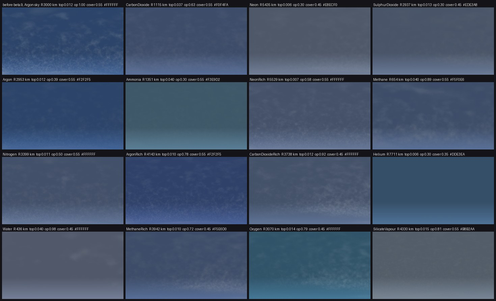

# Clouds, atmospheres and cyclones

How edworld decides what clouds a planet gets, and where to look for cyclones. The settings are in
[users.md](users.md#clouds); the code is `src/atmosphere_kind.h` and `shaders/clouds3d.hlsl`.

## What edworld knows about a planet

edworld reads nothing but what the game draws: no journal, no scan, no network. Every `clouds_kind_read_s`
seconds (10) while the game draws a planet's atmosphere, edworld copies two things the game uses for it:

- **The atmosphere's kind.** The game lights its atmosphere through a table whose colour is one for each kind of
  atmosphere, at every star and on every planet measured (the ratio of red to green and of blue to green of its
  bright half). It follows the kind the scan names, not the mix of gases: an argon atmosphere with some nitrogen
  has the same colour as pure argon. All 15 kinds found on planets you can land on stand apart.
- **The planet's radius and its day.** The planet's radius is in the game's own constants; its day is read off how
  far the planet has turned between two reads (two reads in a row must agree to 1%; while the game moves its frame
  of reference a read is left out). On 74 pairs of reads, 72 gave the scan's day within 1%.

What edworld does not know is the planet's temperature, pressure and gravity. Those come from the typical
landable planet of each kind, out of about 1800 planets with an atmosphere scanned by two commanders.

## Clouds by kind

The layer, its cover and its opacity follow the physics of the kind's typical planet:

- **Height.** An atmosphere's scale height is H = R* T / (M g) (R* the gas constant, M the gas's molar mass): warm, light gases on small planets stand tall,
  cold, heavy gases on large planets lie flat. From thin neon on a large cold world to water vapour on a small warm
  one H spans three orders of magnitude, so edworld presses it into a layer from 0.6% to 4% of the radius
  (`0.012 sqrt((H/R) / 0.0025)`), its floor a quarter of its top.
- **Opacity.** From the typical pressure: `log10(p / 0.001 atm) / 2`, at least 0.3 - an atmosphere of a
  thousandth of the Earth's shows a haze, one of a tenth shows clouds.
- **Cover.** Clouds form where the main gas condenses at the planet's temperature. A gas that condenses there gets
  clouds (cover 0.55); one that does not gets a haze of what else is in the air (0.45); helium, which never
  condenses, the least (0.35).
- **Tint.** A colour per kind, times the star's light, kept close to white. The ices of most of these gases are
  white or colourless, so their clouds are too; a colour of their own comes from what else is in the air: ammonia's
  clouds cream (the compounds that colour Jupiter's), methane's orange-brown (the haze its sunlit chemistry makes, as
  on Titan), less where the methane is only a trace, sulphur dioxide's yellowish (sulphur), silicate vapour's
  grey-brown (dust). Where nothing colours them the kind gets a slight tint only to be told apart from the others -
  cool for argon, helium and carbon dioxide, faintly lilac for neon, faintly pink for nitrogen, blue-white for oxygen.
  Water stays white. `clouds_tint` scales how far from white they are: `0` white everywhere, `2` twice as far.

The "Rich" kinds are named by a gas that is not their main one: in the scans most NeonRich, ArgonRich and
MethaneRich atmospheres are mainly nitrogen (some NeonRich mainly helium), and most CarbonDioxideRich ones mainly
oxygen. They get the clouds of their main gas.

| kind | typical planet (radius, surface) | main gas condenses? | layer top / floor (radius) | opacity | cover | tint |
|---|---|---|---|---|---|---|
| CarbonDioxide | 1115 km, 175 K, 0.018 atm | yes (130-195 K) | 0.0366 / 0.0091 | 0.63 | 0.55 | `#E6EEF8` |
| Neon | 5435 km, 31 K, 0.002 atm | barely (15-27 K) | 0.0060 / 0.0015 | 0.30 | 0.45 | `#ECE4F0` |
| SulphurDioxide | 2937 km, 270 K, 0.003 atm | at its edge (110-260 K) | 0.0126 / 0.0032 | 0.30 | 0.45 | `#EBE0B4` |
| Argon | 2953 km, 69 K, 0.006 atm | yes (50-87 K) | 0.0120 / 0.0030 | 0.39 | 0.55 | `#E4EAF4` |
| Ammonia | 1351 km, 165 K, 0.002 atm | yes (130-200 K) | 0.0400 / 0.0100 | 0.30 | 0.55 | `#EADBC0` |
| NeonRich | 5529 km, 63 K, 0.015 atm | yes, nitrogen (40-80 K) | 0.0067 / 0.0017 | 0.58 | 0.55 | `#F0E8EA` |
| Methane | 654 km, 93 K, 0.059 atm | yes (70-110 K) | 0.0400 / 0.0100 | 0.89 | 0.55 | `#E8CFB0` |
| Nitrogen | 3399 km, 79 K, 0.010 atm | yes (40-80 K) | 0.0109 / 0.0027 | 0.50 | 0.55 | `#F0E8EA` |
| ArgonRich | 4143 km, 83 K, 0.036 atm | at its edge | 0.0104 / 0.0026 | 0.78 | 0.55 | `#F0E8EA` |
| CarbonDioxideRich | 3738 km, 230 K, 0.069 atm | no | 0.0124 / 0.0031 | 0.92 | 0.45 | `#E8F0F8` |
| Helium | 7711 km, 28 K, 0.068 atm | never | 0.0060 / 0.0015 | 0.30 | 0.35 | `#DEE6F0` |
| Water | 436 km, 445 K, 0.092 atm | no (fog at night) | 0.0400 / 0.0100 | 0.98 | 0.45 | white |
| MethaneRich | 3942 km, 140 K, 0.028 atm | no, for methane | 0.0103 / 0.0026 | 0.72 | 0.45 | `#EEDDCB` |
| Oxygen | 3070 km, 181 K, 0.037 atm | no | 0.0140 / 0.0035 | 0.79 | 0.45 | `#E8F0F8` |
| SilicateVapour | 4330 km, 1808 K, 0.042 atm | yes (1500-2500 K) | 0.0152 / 0.0038 | 0.81 | 0.55 | `#B8A898` |

A simulation, not the game: the shape of the clouds worked out as the shader does, seen from the ground at midday on
each kind's typical planet, on the colour of the sky the game's own table gives that kind; the star's light is
white, and the game's exposure and haze are left out, so in the game they may look brighter or fainter. It is meant to compare
the kinds with one another: the first picture is the clouds every planet had before 1.2.0-beta.9.

The opacity is a share of `clouds_opacity`. `clouds_physics_intensity` multiplies it (at most all of it) and, above
1, brings a haze's cover up toward that of clouds, all the way at 2. Until the kind is known, and for a kind not
known, a planet gets the clouds of the ini; once it is known they change over 2 s.

The lumps are not one size over the whole planet: a slow noise makes them larger in some regions and smaller in
others, by a quarter either way (`clouds_size_var`, `0` = one size).

**Where to expect what.** Methane and water worlds are small and have the densest clouds; carbon dioxide worlds
are small to medium with clear, cool decks; nitrogen worlds are medium with plain white clouds; neon and helium
worlds are large and cold and show only a faint haze; sulphur dioxide and ammonia atmospheres are thin, a yellowish
or creamy haze.

## Cyclones

A storm's size is set by the Rossby radius of deformation, L = sqrt(R* T / M) / f, f = 2 Ω sin 45° (Ω from the day;
gravity cancels out). R/L, the planet's radius over it, says how many storms the planet holds:

| R/L | storms |
|---|---|
| under 0.3 | none: the planet turns too slowly or is too small, one flow over all of it |
| 0.3 to 1 | one to three large ones (0.25-0.35 rad across) between 15° and 50°, and one at each pole |
| 1 to 4 | three to six of medium size (0.12-0.2 rad) between 20° and 60° |
| over 4 | six to eight small ones (0.08 rad) |

Each storm turns the planet's way on one half of the planet and the other way on the other, as cyclones do. It is
a Rankine vortex: its core, out to 0.35 of its size, turns as one, and the turn falls with the square of the
distance past it, so the clouds curve in from a distance instead of being drawn out into the middle. Around the eye
the clouds gather into a dense mass; the eye is clear, its edge uneven, and a funnel: narrow at the layer's floor,
wide at its top, with a dense eyewall all the way down, lit on the side facing the sun and shaded on the other.
On a planet with storms the layer is twice as high, the clouds out of storms keeping its lower half. Where the
storms stand comes from the planet's radius, so the same planet always has the same storms. Until the day is read
(about half a minute near the planet) the kind's typical R/L is used. `clouds_cyclones = 0` turns them off.

**Where to look.** R/L of the planets you can land on, from the scans (10th / median / 90th percentile):

| kind | day (median) | R/L | storms on a typical planet |
|---|---|---|---|
| CarbonDioxide | 311 h | 0.01 / 0.05 / 1.17 | none - but see below |
| Neon | 32 h | 1.46 / 3.70 / 8.08 | many, faint in a thin haze |
| SulphurDioxide | 322 h | 0.02 / 0.12 / 1.58 | mostly none |
| Argon | 388 h | 0.02 / 0.09 / 2.34 | mostly none |
| Ammonia | 238 h | 0.01 / 0.05 / 0.47 | none |
| NeonRich | 31 h | 0.08 / 3.62 / 8.59 | many |
| Methane | 393 h | 0.00 / 0.02 / 0.22 | none |
| Nitrogen | 38 h | 0.02 / 1.61 / 3.45 | several, in dense clouds |
| ArgonRich | 52 h | 0.02 / 1.04 / 2.87 | a few |
| CarbonDioxideRich | 47 h | 0.02 / 0.88 / 2.44 | a few large ones |
| Helium | 21 h | 1.58 / 3.13 / 4.69 | several, barely seen |
| Water | 133 h | 0.01 / 0.02 / 0.03 | none |
| MethaneRich | 32 h | 0.02 / 1.46 / 1.96 | several |
| Oxygen | 132 h | 0.12 / 0.24 / 1.00 | mostly none |

Carbon dioxide worlds split by size: under 2500 km (seven in ten) they turn slowly and have no storms; from 2500 km
up they turn in about two days and hold one to three large cyclones with their eyes, the most striking case. Nitrogen
worlds of 3000-4000 km turning in a day or so are the other good place: several cyclones in dense white clouds.
