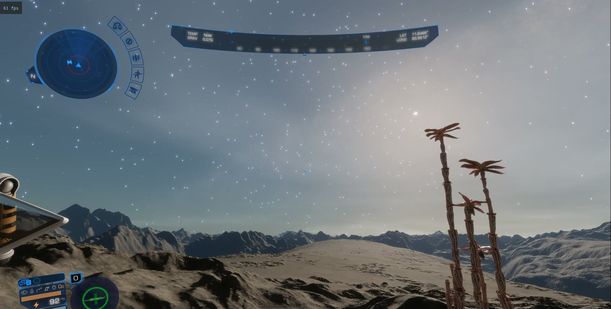

# edworld for players

edworld fixes the panel the game shows while the frame shift drive charges for a jump.

- **The right superpower emblem.** The game shows a wrong emblem there for the Federation, the Empire and the
  Alliance. edworld reads the superpower the panel itself writes and paints the right emblem over the wrong one.
  Independents get the game's phoenix in gold in place of its dull blue one.
- **The destination's factions** under the panel: by influence, the controlling one starred, the trend at the last
  tick, their states. They come from EDSM, or from Elite Help Tool (EHT) when you use it and it has the system.

Both move with the panel when the cockpit camera swings.

**Navballs (since 1.1.0-beta.1).** Two spheres beside the radar show where the selected target is. The left one is
the sphere seen from the front, as the game's compass shows it, with the angles above it: `UP`/`DN` above or below
the wings' plane, `LT`/`RT` left or right of the nose, `BEHIND` when the target is behind you, `NO DOT` when no
target's dot has been read for a second. The dot is told by its colour against the compass's own,
not by a colour of its own, so it is read in the game's HUD colours and in any EDHM theme; a moment when the compass
flashes in the dot's colour is skipped. The right one is the same direction seen from behind, the left and above, with the nose marked and `OFF`,
the target's angle off the nose. In a planet's gravity well it assumes the planet is the target and gives instead
`NOSE` (the nose's angle below or above the horizon), `PUSH DOWN` / `PULL UP` towards a dive of 45°
(`ON PATH` within 2°) and `ALT`, the altitude with the vertical speed.

> **Warning: screen resolution.** The navballs are measured at 9000×2160 over three screens, the cockpit on the
> middle 3840×2160, and checked in a window at 2560×1440 and 1920×1080 too. At a lower resolution, expect less:
> - edworld reads the game's compass off the HUD surface the game draws it into. The game sizes that surface by the
>   picture's height: 2200×1800 at 2160 rows, 1466×1200 at 1440, 1100×900 at 1080. edworld finds it at any of
>   these and reads the compass in its pixels; the settings that place the reading stay in the pixels of the
>   2160-row size. A smaller compass reads coarser: at
>   2160 rows about 0.2° near the nose and about 2° near the rim, at 1080 about twice that.
> - The spheres and their lines are drawn into textures of a fixed size laid on the cockpit, so on screen they
>   shrink with the resolution. Here the lines in the two columns near a planet are about 10 px tall; at
>   1920×1080 they would be about half that, too small to read.
>
> A report of how they work at another resolution (an issue with a screenshot) is welcome.

Besides these, edworld adds clouds, an aurora and snow to planets with an atmosphere ([Clouds](#clouds)) and its
name in a corner of the picture; nothing else in the game changes.

## Which dll

| dll | for |
|---|---|
| `edworld.dll` | anyone: the factions come from EDSM |
| `edworld_eht.dll` | players who run Elite Help Tool: the factions come from EHT's records first, EDSM otherwise. It comes with Elite Help Tool, not with edworld |

## Install

`edworld.dll` is in `edworld-<version>.zip` on the [Releases](https://github.com/arturbac/edworld/releases) page.

### Through edloader

The usual way: [edloader](https://github.com/arturbac/edloader) lets edworld run beside other mods. It is in the zip's
`edloader` folder.

1. Find the game's folder: `Products/elite-dangerous-odyssey-64`, the one with `EliteDangerous64.exe`.
2. Make the folder `edloader\plugins` in your user folder:
   - Windows (Steam, Epic, Frontier): `C:\Users\<you>\edloader\plugins`
   - Linux, Steam: `.../steamapps/compatdata/359320/pfx/drive_c/users/steamuser/edloader/plugins`
3. Copy edloader's `d3d11.dll` into the game's folder. If a `d3d11.dll` is there already (EDHM, EDVR), first move it
   as [edloader's guide, Install](https://github.com/arturbac/edloader/blob/main/doc/users.md#install) tells (step 3).
4. Copy `edworld.dll` into `edloader\plugins`.
5. Make the file `edloader\edloader.txt` with one line: `edworld.dll`.
6. Start the game.

Only if you use them:

- **EDHM or EDVR:** [edloader's guide, Install](https://github.com/arturbac/edloader/blob/main/doc/users.md#install)
  (steps 3 and 5: their files and lines) and, with EDHM-UI, its
  [EDHM-UI](https://github.com/arturbac/edloader/blob/main/doc/users.md#edhm-ui) part.
  With EDVR's anti-aliasing on, set `ui_quality = off` in EDVR (F8), or the navballs are gone.
- **Epic Games Store, ReShade or an antivirus:** nothing to set. Only if edloader's log says `TAKEOVER:`, see
  [edloader's guide](https://github.com/arturbac/edloader/blob/main/doc/users.md#a-mod-that-takes-the-games-calls-itself).

### On its own

For edworld as the only d3d11 mod, or for a player who does not want edloader.

1. Find the game's folder: `Products/elite-dangerous-odyssey-64`, the one with `EliteDangerous64.exe`.
2. If there is a `d3d11.dll` in it already (EDHM, ReShade, EDVR), rename it, for example to `d3d11_edhm.dll`.
3. Copy edworld's dll into the game's folder as `d3d11.dll`.
4. If you renamed another mod's dll in step 2, create `edworld.ini` (or `edworld_eht.ini`) beside it with
   `next = d3d11_edhm.dll` (the name you gave it).
5. Start the game; `edworld.log` (or `edworld_eht.log`) appears beside the dll.

The log holds one game session. At the next start the last session's log is moved to the folder `edworld` (or
`edworld_eht`) beside it, named after the time of its last write (UTC): `edworld\edworld.20261124T013956Z.log`. Two
sessions whose logs end in the same second share that name; the second one then stays in `edworld.log` and the new
session goes on after it. Loaded through edloader, the log and that folder are in edloader's `logs` folder; installed
alone they are in the game's folder, and Steam's or the launcher's check of the game's files removes them.

### With Elite Help Tool

`edworld_eht.dll` comes with Elite Help Tool. It reads what EHT knows of your destination from a shared folder, `shm_dir` in its ini. It must be
the folder EHT writes to (`edworld.dir` in EHT's `eht_settings.json`), as seen from the game: EHT's
`/dev/shm/eht-sjona` is `Z:\dev\shm\eht-sjona` for the game under Proton. Give each commander's EHT a folder of its
own: two tools writing one folder replace each other's destination.

While the galaxy map is open, `edworld_eht.dll` also reads the names the map shows (`galmap`) and puts them there for
EHT. Letters it has not learned yet come out as `?`.

Each time it reads a planet's atmosphere off the render, `edworld_eht.dll` also puts that planet's print there
(`atmosphere`): its radius, the hue of the game's table of its air and whether that is one of the prints edworld knows
(its kind) or a new one, so EHT can tell you when a planet's atmosphere is a case never seen.

## Settings

In `edworld.ini` (or `edworld_eht.ini`), beside the dll or in `edloader\config`. `;` or `#` starts a comment: a line
of its own, or after a value and a space (`clouds = 1 ; on`). Every setting has a default. At its first start edworld makes the file if there is none, with every
setting as a comment holding the value it runs on (`;clouds = 1`), and at each start it adds the settings
the file does not name yet, a new version's too, at the end; it never changes a line that is there. To change a
setting, take the `;` off its line; a line left as a comment follows edworld's default, also when a new version
changes it. Where the file cannot be written, edworld says so in its log and runs on. A value edworld cannot read (a
decimal comma, `0,45`; a word where a number goes; a name with a typo) keeps the value it had, its default unless an earlier line set it, and the log says
which line (`settings: line ...`). After a path or a dll's name (`next`, `status_file`, `shm_dir`) a `;` or `#` is
part of the value, not a comment. `status_file` is left empty in
the file edworld writes: empty means the Saved Games folder, and the file then holds no Windows user name.

| setting | default | what |
|---|---|---|
| `patch` | `1` | the jump panel: `0` off, `1` the emblem and the list, `2` a test frame showing where they go |
| `list` | `1` | `0` = no factions list |
| `edsm` | `1` | `0` = never ask EDSM (no list then without EHT) |
| `compass` | `1` | `0` = no navballs; the game's compass is then not read at all |
| `compass_spheres` | `1` | `0` = no spheres |
| `compass_text` | `0` | `1` = the angles also written above the radar |
| `compass_hide_game` | `1` | `1` = the game's own compass hidden once read (the left sphere stands in for it) |
| `pad_text_read` | `1` | the pad's number read from the tower's notice on the HUD; `0` = off |
| `clouds` | `1` | clouds over a planet with an atmosphere that the game draws without any, `0` = none: see [Clouds](#clouds) |
| `clouds_volume` | `1` | clouds with depth you fly through; `0` = the flat layer, lighter for a weaker graphics card |
| `aurora` | `1` | `1` = an aurora over the night side of a planet whose atmosphere's kind is known, `0` = none |
| `snow` | `1` | `1` = snow of the air's own gas near you under the clouds of an ammonia or methane planet, `0` = none |
| `build_info` | `3` | edworld's name and version in a corner: `1` top left, `2` top right, `3` bottom right, `4` bottom left, `0` none |
| `galmap` | `1` | `edworld_eht.dll` only: the names the galaxy map shows, put there for EHT; `0` = off |
| `shader_catalog` | `1` | `edworld_eht.dll` only: each shader the game creates kept once per build of the game; `0` = none |

Every other setting (how the clouds, the aurora and the navballs look, where the list and the spheres stand, the
tests) is in [settings.md](settings.md), by its topic, with its default, its range and whether a change shows while
the game runs.

### Navball colours

The spheres are a muted grey by default. Their colours (`RRGGBB` each, no `#`) and their brightness are
settings: [settings.md](settings.md), the navballs.

EDSM is asked once per new destination, with the system's id only.

## Clouds

A planet the game gives an atmosphere and no clouds gets a layer of them (`clouds = 0` turns them off): from orbit, on the way
through it and from under it on the ground. The clouds are worked out from noise on the graphics card, each planet
its own; the game's data is not used for them and nothing of them reaches anyone else, they are only in your picture.
They have depth and drift with the wind, faster high up: you fly into them and they thin out around you as you pass, and near you they have lumps with clear sky among them. That costs the graphics card more; if the
game slows down near a planet, `clouds_volume = 0` in the ini gives the flat layer instead, which has no depth and is
lighter. They are there only
where the game draws its shell of the atmosphere, found by that shader, so an update of the game can take them away
until edworld follows it. Changing a value takes a new start of the game, but for those
[settings.md](settings.md) lists as read while the game runs.

The clouds with depth are worked out at half the picture's width and height and laid over it by the depth of the
scene, so they keep to the edge of the ground and the ship. Every 5 s the log has a line `clouds gpu 5s` with how
long the graphics card spends on them (`ms median`, from one draw in five) and how many pixels that takes; with a
report about the speed of the game near a planet, that line helps.
Toward the horizon, where the way through the clouds is longest, they can show a fine, even grain.

The clouds with depth follow the atmosphere's kind. The kind is told by how the game's own
atmosphere draws it (its colour table), not by the journal: each of the 15 kinds on planets you land on gets its own
layer, height, cover, opacity and tint, from the physics of the kind's typical planet (its temperature, pressure,
size). A gas that does not condense at its planets' temperatures gives a thin haze, not clouds; large cold planets
get a thin, low layer, small warm ones a deep one. Until the kind is told (a few seconds after the planet comes near)
and for a kind not known the clouds are as above; then they change over 2 s. The log has
`clouds: the planet of radius ... m is <kind>`. How strongly they show, their colour, and the same clouds on every
planet to compare are settings ([settings.md](settings.md)), read again while the game runs; what each kind gets and
why is in [clouds.md](clouds.md). edworld reads the game's atmosphere every 10 seconds while it is drawn. Nothing of it is written anywhere. When no read of
the atmosphere gets through for a minute, the log says why (`atmo: no read of the shell got through in a minute: ...`).

Storms: in the kinds' clouds, cyclones with spiral arms and a clear eye, as many and as large
as the planet's size, its day and its kind allow. edworld reads the day off the planet's turn in the picture
(`clouds: the planet of radius ... m turns in ... h` in the log, after half a minute or so near it); a planet that turns
slowly or is small has none, a large one turning in a day or two has one to three large ones and one at each pole, a
fast large one several smaller ones. They turn the planet's way on one half, the other way on the other. The log has
`clouds: N storm(s) on the planet ...`. Which planets to visit for them: [clouds.md](clouds.md#cyclones).

Lumps and weather: in the kinds' clouds the lumps' size follows the
cloud layer's thickness and each lump is as high as it is strong; the clouds gather on the day side of a planet
that turns slowly for its size and lie in bands by latitude on a faster one. Why: [clouds.md](clouds.md).

Aurora (`aurora`): on the night side of a planet whose kind is known, an oval of curtains around a pole, over
the clouds, coloured by the gas (oxygen green and red, nitrogen violet with a pink edge, neon orange, ...). Whether
the planet has one and how strong it is follow its size, its turn and its star; how stormy follows the time, each 3
hours its own and the same for every player. In a substorm, every hour or two, it brightens over minutes and dances
for a quarter of an hour. Seen from the ground under a dark sky, through the clouds' gaps, and from orbit over the
night side. The log has `aurora: the planet of radius ... m has a field of its own ...` once per planet. To see a
strong one now: `aurora_activity = 7` and `aurora_field = 1` (test settings, [settings.md](settings.md)). Where and why, its colours and how often: [auroras.md](auroras.md).

## Check that it works

edworld's name and version stand small and grey in the screen's bottom right corner (`build_info` moves it); the log's
`build_info:` line says where it went. Without them edworld
is not running, or found no picture to draw into (`build_info: no swap chain's back buffer ...`). With edupscale or
edwide_screen loaded too, a line for each stands next to edworld's (above it at a bottom corner, below at a top one): its
version and what it does now (edupscale's technique, edwide_screen's wings), so you see they run.

The log lists `patch: first drawn` at your first charge, `superpower: ... reads Alliance on the panel` (or the
Federation, the Empire, Independent) for each new destination and `list: N faction(s) ... drawn, from EDSM` (or
`from the data source`, EHT). A system without a superpower (deep space) gets no emblem, and one without factions
no list.

Navballs: the log lists `compass: first drawn`, `compass: the left sphere first drawn by its anchor` (and the right
one), and `compass: the left sphere's centre at local (...)` with its size each time its place changes, for example
in another ship.

### What the log says about your setup

At each start the log lists the machine the game runs on and the game's graphics options, so a log you send tells
what it ran on without more questions: `machine:` lines (Windows or Wine, the processor, the memory, each graphics
card with its driver and its displays) and `graphics:` lines (the game's `DisplaySettings.xml`, `Settings.xml`,
`StartPreset.start` and its custom preset). For each graphics device the game makes, a `device ...: card ...` line
gives the card it stands on. Only names and numbers: no folder and no user name.

Each device's line says who asked for it (`asked by EliteDangerous64.exe`). An overlay that makes a device of its own
from outside the game's folder (Epic's overlay `EOSOVH-Win64-Shipping.dll`, for example) is logged as
`from outside the game's folder: not followed`: edworld stays with the game's device.

Some programs put themselves in the game's own call for its device, an antivirus's hooks for example. Then the
game's device too is logged as asked by that dll and `not followed`, and edworld draws nothing. The line names the
dll and the fix: add it to `edworld.ini` as `creator_pass = <its name>` (several by commas; `bdhkm64.dll`, seen in a
player's log, is there by default, so keep it in the list). edworld then passes it
over, finds the game behind it and logs `asked by EliteDangerous64.exe (past <its name>: creator_pass)`. Do not add an
overlay's dll there (Epic's, Discord's, Steam's): edworld would follow the overlay's device instead of the game's.

A line `warning: dll before edworld in the chain: ...` names each mod that stood before edworld in the chain (the
file, its product and version; edloader itself gets a plain `chain: before edworld:` line), for a failure to tell who
was there. Other mods before edworld are allowed; with
edloader, `edworld.dll` (or `edworld_eht.dll`) best stands before EDHM in `edloader.txt`.

30 seconds and 5 minutes after the start, `census` lines count the game's draws edworld saw and say whether its
hooks are still in place (`draw hooks in place`, or which dll took them). No draws seen, or hooks taken, means
edworld sees nothing of the game: the navballs, the panel and the clouds stay away.

### Testing the navballs

For each ship you fly with edworld, open an [issue](https://github.com/arturbac/edworld/issues) with the ship's
type, a screenshot with both spheres and the log (`edworld.log` or `edworld_eht.log`). If a sphere sits in a bad
place, say where you would like it; the navballs' settings ([settings.md](settings.md)) move it, and the
values you used help too.

## After a verification of the game's files

Steam's and the launcher's verification removes from the game's folder everything that is not the game's: edworld's
dll and its ini. Copy them again. Through edloader only edloader's `d3d11.dll` has to be copied again.

## Remove

Delete edworld's `d3d11.dll` and its ini; put back the mod's dll you renamed, as `d3d11.dll`. Through edloader: delete `edworld.dll`
from `edloader\plugins` and its line from `edloader.txt`.

## Known

- The game's wrong emblem may show for a few frames at the first charge to a destination, while edworld reads the
  panel.
- Below 2160 rows the game draws the jump panel smaller than 3072×660, and edworld leaves it as it is: the game's
  emblem stays. The pad's number is read off the HUD at 2160 rows only as well.
- After an on-foot conflict zone edworld once saw no panel for about four minutes; the jump panel kept the game's
  emblem until then.
- Navballs: the spheres held their places in the Kestrel, the Anaconda, the Panther Clipper Mk II, the Mandalay, the
  Type-8, the Type-11 Prospector, the Federal Corvette and the Nomad; in other cockpits they may sit too close to or too far from the radar. Near a planet the lines are checked at one surface port
  (two landings); in the two columns they are small, about 10 px tall at 3840×2160. With a settlement or a surface
  port targeted, `NOSE` and `PUSH DOWN` / `PULL UP` still take the planet's centre as the target and are wrong there.
  The game does not draw its compass every frame; a sphere keeps its last reading in between.
- Approach view (checked at an outpost in space and at a surface port): near a pad the game's compass puts the target on its rim, so ahead or behind is
  read from a fraction of a pixel there (a few degrees at best), left or right to about a degree. The right
  sphere's dome comes only with the left sphere's view from above, with the target near; its base is parallel to the
  ship's wings, not to the ground (Status.json gives neither pitch nor roll).
- The Empire's, the Federation's and the independents' words on the panel were measured on screenshots; a word
  edworld does not recognise leaves the game's emblem and says so in the log.
